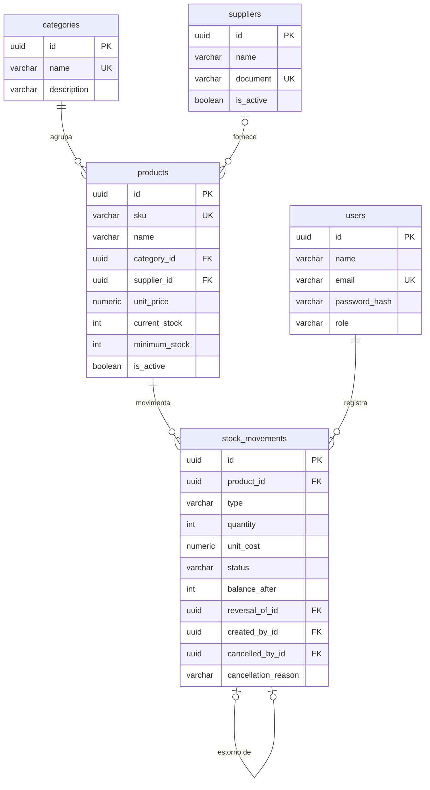

# StockCore API

[](https://github.com/ruangdev0-ux/stockcore-api/actions/workflows/ci.yml)

API REST de controle de estoque: produtos, categorias, fornecedores, entradas, saídas, cancelamento com estorno, estoque mínimo com alertas e relatórios, com autenticação JWT e permissões por papel.

Projeto pessoal de portfólio para praticar desenvolvimento back-end com **C#, .NET 8, ASP.NET Core, Entity Framework Core e PostgreSQL**. Todos os dados de exemplo são fictícios.

Documentação interativa (OpenAPI): **https://ruangdev0-ux.github.io/stockcore-api/**

## O problema

Em um estoque pequeno, o saldo costuma ser controlado em planilha: alguém digita uma saída a mais, o número fica negativo, ninguém sabe quem mudou o quê e um erro corrigido some do histórico. A StockCore API resolve isso com regras explícitas: o saldo só muda por movimentações, nunca fica negativo (nem com duas saídas ao mesmo tempo), lançamentos errados são cancelados com estorno em vez de apagados e o sistema avisa quando um produto chega ao estoque mínimo.

## Funcionalidades

-   Login com **JWT** e senhas com hash PBKDF2 (`PasswordHasher` do ASP.NET Core Identity)
-   Três papéis: `Admin`, `Operator` e `Viewer`
-   Cadastro de **categorias**, **fornecedores** e **produtos** (SKU único, preço, estoque mínimo)
-   **Entradas e saídas** de estoque com saldo após cada movimento
-   **Cancelamento com estorno**: o lançamento original fica marcado como cancelado e um movimento de estorno desfaz o efeito, na mesma transação
-   **Alerta de estoque mínimo** e indicador `lowStockAlert` na resposta de cada movimentação
-   **Relatórios**: resumo do estoque (unidades, valor, produtos abaixo do mínimo) e totais de movimentações por período e por produto
-   **Filtros, ordenação e paginação** em produtos, fornecedores e movimentações
-   **Validação** com FluentValidation e erros no formato **ProblemDetails** com um campo `code` estável
-   **Swagger/OpenAPI** com autenticação Bearer, e `GET /health` checando o banco

## Regras de negócio

| #   | Regra                                                                                                                                                   | Onde está                                                   |
| --- | ------------------------------------------------------------------------------------------------------------------------------------------------------- | ----------------------------------------------------------- |
| 1   | O estoque nunca fica negativo: a regra está no domínio e também numa check constraint do banco (`current_stock >= 0`).                                  | `StockRules.EnsureCanRemove`, `ProductConfiguration`        |
| 2   | Saída maior que o saldo é recusada com **422** e `details: { available, requested }`.                                                                   | `StockRules.EnsureCanRemove`                                |
| 3   | Movimentações não são apagadas: não existe `DELETE /api/movements` (a rota responde 405).                                                               | `MovementsController`                                       |
| 4   | Cancelar gera um **estorno**: marca o original como `Cancelled` (quem, quando e motivo obrigatório), cria o `Reversal` e ajusta o saldo numa transação. | `Product.CancelMovement`, `MovementService.CancelAsync`     |
| 5   | Cancelar uma entrada só é permitido se o saldo atual cobrir a quantidade; não se cancela duas vezes nem se cancela um estorno (422).                    | `StockRules.EnsureCanCancel`                                |
| 6   | Produto inativo não aceita entrada nem saída (422). Correções por cancelamento continuam permitidas.                                                    | `StockRules.EnsureCanReceive`, `EnsureCanRemove`            |
| 7   | Alerta quando o saldo chega ao mínimo ou fica abaixo: `GET /api/alerts/low-stock` e `lowStockAlert` na resposta da movimentação.                        | `StockRules.IsLowStock`, `AlertService`                     |
| 8   | Concorrência: operações no mesmo produto são serializadas com `SELECT ... FOR UPDATE`; saídas simultâneas nunca deixam o saldo negativo.                | `MovementService.LockProductAsync`, `ConcurrencyTests`      |
| 9   | Categoria com produtos não é excluída (409). Produto com movimentações não é excluído, só inativado (409).                                              | `CategoryService.DeleteAsync`, `ProductService.DeleteAsync` |
| 10  | Permissões: `Viewer` só consulta; `Operator` registra entradas e saídas; cancelamento, cadastros e usuários são só do `Admin`.                          | `[Authorize(Roles = ...)]` nos controllers                  |
| 11  | SKU único (409, sem diferenciar maiúsculas); quantidade inteira maior que zero (400); preço e estoque mínimo não negativos (400).                       | `ProductService`, `ProductValidators`, `MovementValidators` |
| 12  | Fornecedor inativo não pode ser vinculado a um produto (422).                                                                                           | `ProductService.EnsureSupplierIsActiveAsync`                |

## Stack

| Área             | Tecnologia                                                  |
| ---------------- | ----------------------------------------------------------- |
| Linguagem        | C# 12 com nullable reference types                          |
| Framework        | .NET 8 (LTS) e ASP.NET Core Web API com controllers         |
| Banco de dados   | PostgreSQL 16                                               |
| ORM e migrations | Entity Framework Core 8 com Npgsql e nomes em `snake_case`  |
| Autenticação     | JWT Bearer e `PasswordHasher<T>` (PBKDF2)                   |
| Validação        | FluentValidation 11                                         |
| Documentação     | Swashbuckle (OpenAPI 3) e Swagger UI                        |
| Testes           | xUnit, FluentAssertions e `WebApplicationFactory`           |
| CI               | GitHub Actions com serviço PostgreSQL e publicação no Pages |
| Ambiente local   | Docker Compose (banco)                                      |

## Arquitetura

A solução tem quatro projetos, e cada um só depende do que está "para dentro":

```
StockCore.sln
src/
├── StockCore.Domain/          # entidades e regras puras, sem nenhum pacote externo
│   ├── Entities/              # Product, Category, Supplier, StockMovement, User
│   ├── Enums/                 # MovementType, MovementStatus, UserRole
│   ├── Rules/StockRules.cs    # pode sair? pode cancelar? está abaixo do mínimo?
│   └── Exceptions/            # BusinessRule, NotFound, Conflict, Unauthorized
├── StockCore.Application/     # contratos dos casos de uso, DTOs e validadores
│   └── Products/ Movements/ Reports/ ...
├── StockCore.Infrastructure/  # EF Core, migrations, serviços, JWT, hash de senha, seed
│   ├── Persistence/           # AppDbContext, configurações, migrations, seed
│   ├── Services/              # implementação dos casos de uso
│   └── Security/
└── StockCore.Api/             # controllers, Program.cs, erros, autenticação e Swagger
tests/
├── StockCore.UnitTests/        # regras, entidade Product, validadores e relatórios
└── StockCore.IntegrationTests/ # API completa com WebApplicationFactory + PostgreSQL
```

```
Api ──► Application ──► Domain
 │           ▲
 └──► Infrastructure (implementa as interfaces de Application usando EF Core)
```

Fluxo de uma saída de estoque:

```
POST /api/movements/exits
  → JwtBearer (401) → [Authorize(Roles = "Admin,Operator")] (403)
  → ValidationFilter: FluentValidation (400)
  → MovementsController → MovementService
      BEGIN; SELECT ... FOR UPDATE na linha do produto
      Product.RegisterExit → StockRules (422 se não puder)
      INSERT do movimento + UPDATE do saldo; COMMIT
  → 201 com o movimento, o saldo atual e lowStockAlert
  (qualquer exceção → GlobalExceptionHandler → ProblemDetails)
```

## Banco de dados



-   Check constraints: `current_stock >= 0`, `minimum_stock >= 0`, `unit_price >= 0` e `quantity > 0`.
-   Índices: SKU (único), produto por categoria, movimentos por produto e data, por tipo, e `reversal_of_id` único (um movimento só tem um estorno).
-   A coluna de sistema `xmin` do PostgreSQL é usada como token de concorrência do produto: duas edições simultâneas do mesmo cadastro resultam em 409 em vez de uma sobrescrever a outra.
-   A migration inicial fica em [`src/StockCore.Infrastructure/Persistence/Migrations`](src/StockCore.Infrastructure/Persistence/Migrations).

## Como executar

Pré-requisitos: .NET 8 SDK e Docker (ou um PostgreSQL 16 local).

```bash
git clone https://github.com/ruangdev0-ux/stockcore-api.git
cd stockcore-api
docker compose up -d                       # PostgreSQL em localhost:5432 (bancos stockcore e stockcore_test)

# A chave do JWT não fica no repositório: guarde-a nos user-secrets (ou na variável Jwt__Key)
dotnet user-secrets set "Jwt:Key" "$(openssl rand -base64 48)" --project src/StockCore.Api

dotnet run --project src/StockCore.Api     # http://localhost:5080 · Swagger em /swagger
```

Em `Development`, a API aplica as migrations e o seed fictício ao iniciar (`Database:ApplyMigrationsOnStartup` e `Database:Seed`). Para aplicar as migrations manualmente:

```bash
dotnet tool restore
dotnet ef database update --project src/StockCore.Infrastructure --startup-project src/StockCore.Api
```

Usuários do seed (senha de demonstração `demo12345`, só para uso local): `admin@exemplo.com` (Admin), `operador@exemplo.com` (Operator) e `leitor@exemplo.com` (Viewer). O seed também cria 3 categorias, 2 fornecedores com CNPJ fictício, 8 produtos e algumas movimentações, incluindo um cancelamento.

## Configuração

| Chave (variável de ambiente)                               | Descrição                                        | Padrão                               |
| ---------------------------------------------------------- | ------------------------------------------------ | ------------------------------------ |
| `ConnectionStrings:Default` (`ConnectionStrings__Default`) | conexão do PostgreSQL                            | obrigatória                          |
| `Jwt:Key` (`Jwt__Key`)                                     | chave de assinatura, mínimo 32 caracteres        | obrigatória                          |
| `Jwt:Issuer` / `Jwt:Audience`                              | emissor e público do token                       | `StockCore.Api` / `StockCore.Client` |
| `Jwt:ExpirationMinutes`                                    | validade do token                                | `60`                                 |
| `Database:ApplyMigrationsOnStartup`                        | aplica as migrations ao iniciar                  | `false` (`true` em Development)      |
| `Database:Seed`                                            | cria os dados fictícios se o banco estiver vazio | `false` (`true` em Development)      |
| `TEST_CONNECTION_STRING`                                   | banco usado pelos testes de integração           | `stockcore_test` local               |

A configuração é validada ao iniciar: sem `Jwt:Key` (ou com menos de 32 caracteres) a API não sobe e diz o que falta. O arquivo [`.env.example`](.env.example) lista todas as variáveis.

## Rotas

Todas, exceto login, `/health` e `/swagger`, exigem `Authorization: Bearer <token>`.

| Método             | Rota                                          | Quem            | Descrição                                  |
| ------------------ | --------------------------------------------- | --------------- | ------------------------------------------ |
| POST               | `/api/auth/login`                             | todos           | devolve o token JWT                        |
| GET                | `/api/auth/me`                                | logado          | usuário do token                           |
| GET / POST         | `/api/users`                                  | Admin           | lista / cria usuário                       |
| GET / POST         | `/api/categories`                             | logado / Admin  | lista / cria                               |
| GET / PUT / DELETE | `/api/categories/{id}`                        | logado / Admin  | detalhe, edição, exclusão (sem produtos)   |
| GET / POST         | `/api/suppliers`                              | logado / Admin  | lista (filtros) / cria                     |
| GET / PUT          | `/api/suppliers/{id}`                         | logado / Admin  | detalhe / edição                           |
| PATCH              | `/api/suppliers/{id}/deactivate`              | Admin           | inativa                                    |
| GET / POST         | `/api/products`                               | logado / Admin  | lista (filtros) / cria com saldo zero      |
| GET / PUT / DELETE | `/api/products/{id}`                          | logado / Admin  | detalhe, edição, exclusão (sem movimentos) |
| PATCH              | `/api/products/{id}/activate` e `/deactivate` | Admin           | ativa / inativa                            |
| GET                | `/api/products/{id}/movements`                | logado          | histórico do produto                       |
| POST               | `/api/movements/entries`                      | Admin, Operator | registra entrada                           |
| POST               | `/api/movements/exits`                        | Admin, Operator | registra saída                             |
| POST               | `/api/movements/{id}/cancel`                  | Admin           | cancela com estorno                        |
| GET                | `/api/movements` e `/api/movements/{id}`      | logado          | lista com filtros / detalhe                |
| GET                | `/api/alerts/low-stock`                       | logado          | produtos no mínimo ou abaixo               |
| GET                | `/api/reports/stock-summary`                  | logado          | resumo do estoque                          |
| GET                | `/api/reports/movements?from&to`              | logado          | totais do período (padrão: 30 dias)        |
| GET                | `/health`                                     | todos           | saúde da API e do banco                    |

### Filtros

-   Produtos: `GET /api/products?search=agua&categoryId=...&supplierId=...&isActive=true&lowStock=true&sort=-stock&page=1&pageSize=20`
    -   `sort`: `name`, `sku`, `stock`, `price` ou `createdAt`; com `-` na frente fica decrescente
-   Movimentações: `GET /api/movements?productId=...&type=Exit&status=Active&from=2026-10-01T00:00:00Z&to=2026-10-31T23:59:59Z`
-   `pageSize` vai até 100. As listagens paginadas devolvem `items`, `page`, `pageSize`, `totalItems` e `totalPages`.

## Exemplos

Respostas reais da API com o seed fictício (ids encurtados). Foram capturadas no GitHub Actions, com a API rodando contra o PostgreSQL do workflow.

**Login**

```http
POST /api/auth/login
Content-Type: application/json

{ "email": "operador@exemplo.com", "password": "demo12345" }
```

```json
{
    "accessToken": "eyJhbGciOiJIUzI1NiIs…",
    "tokenType": "Bearer",
    "expiresAt": "2026-10-30T13:13:05.9068871Z",
    "user": {
        "id": "fec244ea-…",
        "name": "Operador Exemplo",
        "email": "operador@exemplo.com",
        "role": "Operator",
        "createdAt": "2026-10-30T12:13:04.661219Z"
    }
}
```

**Saída que atinge o estoque mínimo** (`201`)

```http
POST /api/movements/exits
Authorization: Bearer <token>

{ "productId": "a5f19bb6-…", "quantity": 100, "note": "Venda atacado" }
```

```json
{
    "movement": {
        "id": "c4a17c93-…",
        "productId": "a5f19bb6-…",
        "productSku": "BEB-001",
        "productName": "Água mineral 500 ml",
        "type": "Exit",
        "quantity": 100,
        "unitCost": null,
        "note": "Venda atacado",
        "status": "Active",
        "balanceAfter": 20,
        "reversalOfId": null,
        "createdById": "fec244ea-…",
        "createdByName": "Operador Exemplo",
        "createdAt": "2026-10-30T12:13:06.103941Z",
        "cancelledAt": null,
        "cancelledById": null,
        "cancellationReason": null
    },
    "currentStock": 20,
    "minimumStock": 24,
    "lowStockAlert": true
}
```

**Saída maior que o saldo** (`422`)

```json
{
    "title": "Regra de negócio violada",
    "status": 422,
    "detail": "Estoque insuficiente para a saída.",
    "instance": "/api/movements/exits",
    "code": "BUSINESS_RULE_VIOLATION",
    "details": { "available": 20, "requested": 50 },
    "traceId": "0HNPMFSJGT4PT:00000001"
}
```

**Cancelamento com estorno** (`201`, só Admin)

```http
POST /api/movements/c4a17c93-…/cancel
Authorization: Bearer <token do admin>

{ "reason": "Quantidade digitada errada" }
```

```json
{
    "movement": {
        "id": "3a60a809-…",
        "productSku": "BEB-001",
        "type": "Reversal",
        "quantity": 100,
        "note": "Quantidade digitada errada",
        "status": "Active",
        "balanceAfter": 120,
        "reversalOfId": "c4a17c93-…",
        "createdByName": "Admin Exemplo",
        "createdAt": "2026-10-30T12:13:06.27722Z"
    },
    "currentStock": 120,
    "minimumStock": 24,
    "lowStockAlert": false
}
```

Cancelar o mesmo movimento de novo devolve `422` com `"detail": "Esta movimentação já foi cancelada."`.

**Erro de validação** (`400`)

```json
{
    "title": "Dados inválidos",
    "status": 400,
    "detail": "Um ou mais campos são inválidos.",
    "instance": "/api/movements/exits",
    "code": "VALIDATION_ERROR",
    "errors": {
        "quantity": ["A quantidade deve ser um número inteiro maior que zero."]
    },
    "traceId": "0HNPMFSJGT4PV:00000001"
}
```

**Viewer tentando registrar saída** (`403`)

```json
{
    "title": "Acesso negado",
    "status": 403,
    "detail": "Seu papel não permite esta operação.",
    "instance": "/api/movements/exits",
    "code": "FORBIDDEN",
    "traceId": "0HNPMFSJGT4PU:00000001"
}
```

**Alertas e resumo**

```http
GET /api/alerts/low-stock
```

```json
[
    {
        "productId": "b0057c35-…",
        "sku": "LIM-001",
        "name": "Detergente 500 ml",
        "categoryName": "Limpeza",
        "currentStock": 10,
        "minimumStock": 20,
        "shortage": 10
    },
    {
        "productId": "b533691e-…",
        "sku": "MER-001",
        "name": "Arroz tipo 1 5 kg",
        "categoryName": "Mercearia",
        "currentStock": 6,
        "minimumStock": 8,
        "shortage": 2
    },
    {
        "productId": "be9eaa9a-…",
        "sku": "BEB-002",
        "name": "Suco de uva 1 L",
        "categoryName": "Bebidas",
        "currentStock": 8,
        "minimumStock": 10,
        "shortage": 2
    }
]
```

```http
GET /api/reports/stock-summary
```

```json
{
    "activeProducts": 8,
    "totalUnits": 304,
    "totalValue": 1599.6,
    "lowStockProducts": 3,
    "outOfStockProducts": 0
}
```

### Códigos de erro

Todos os erros seguem o ProblemDetails (RFC 9457), com `Content-Type: application/problem+json`, e trazem `code` e `traceId`.

| HTTP | `code`                    | Quando                                                          |
| ---- | ------------------------- | --------------------------------------------------------------- |
| 400  | `VALIDATION_ERROR`        | campo inválido, JSON malformado, quantidade não inteira         |
| 401  | `UNAUTHORIZED`            | token ausente, inválido ou expirado; e-mail ou senha incorretos |
| 403  | `FORBIDDEN`               | o papel não permite a operação                                  |
| 404  | `NOT_FOUND`               | recurso não existe                                              |
| 409  | `CONFLICT`                | SKU, e-mail, nome ou documento repetido; exclusão bloqueada     |
| 422  | `BUSINESS_RULE_VIOLATION` | regra de estoque impede a operação                              |

## Testes

```bash
docker compose up -d                       # o banco stockcore_test é criado junto
dotnet test                                # unitários + integração
dotnet test tests/StockCore.UnitTests      # só os unitários (não precisam de banco)
```

-   **Unitários** (`tests/StockCore.UnitTests`, 44 casos): `StockRules`, a entidade `Product` (entrada, saída, cancelamento, alerta), os validadores do FluentValidation e os cálculos dos relatórios. Funções puras, sem banco.
-   **Integração** (`tests/StockCore.IntegrationTests`, 46 casos): a API inteira com `WebApplicationFactory` contra um PostgreSQL real. As migrations são aplicadas na inicialização e as tabelas são limpas antes de cada teste. Cobrem login e 401/403 por papel, CRUD e exclusões bloqueadas, entrada → saída → cancelamento com estorno, saída maior que o saldo, produto inativo, duplo cancelamento, filtros e paginação, alertas, relatórios, formato ProblemDetails, `/health`, Swagger e **concorrência** (10 saídas simultâneas com saldo 5: passam exatamente 5).
-   **Teste de mutação manual**: a regra de saldo foi quebrada de propósito (`requested > available` virou `requested > available + 1000`) e os testes falharam (2 unitários e 1 de integração), confirmando que a regra está coberta.

Os 90 testes rodam no GitHub Actions a cada push. O banco de teste padrão é `Host=localhost;Database=stockcore_test;Username=stockcore;Password=stockcore` e pode ser trocado com a variável `TEST_CONNECTION_STRING`.

## CI

O workflow [`ci.yml`](.github/workflows/ci.yml) roda a cada push e pull request:

1. `dotnet restore` e restauração do `dotnet-ef`;
2. `dotnet format --verify-no-changes`;
3. `dotnet build` em Release, com avisos do compilador tratados como erro;
4. `dotnet ef migrations has-pending-model-changes`, que falha se o modelo mudou sem migration;
5. `dotnet test` (unitários e integração) com um serviço PostgreSQL 16;
6. na branch `main`, sobe a API, exporta o `openapi.json` e publica a documentação no GitHub Pages.

## Decisões técnicas

-   **Camadas com dependência para dentro**: o domínio não conhece EF Core nem HTTP, então as regras de estoque são testadas em milissegundos, sem banco.
-   **Regras no domínio e no banco**: o domínio dá a mensagem clara (422 com saldo disponível); a check constraint garante que nenhuma escrita, nem um bug, deixe o saldo negativo.
-   **`SELECT ... FOR UPDATE` nas movimentações**: a transação trava a linha do produto antes de ler o saldo, então duas saídas simultâneas são processadas uma depois da outra. Há um teste com 10 saídas em paralelo.
-   **Estorno em vez de exclusão**: o histórico continua completo e o saldo após cada movimento (`balanceAfter`) fica registrado.
-   **Saldo só muda por movimentação**: o produto nasce com saldo zero e o `PUT` não aceita saldo.
-   **Sem MediatR, CQRS ou repositório genérico**: um serviço por caso de uso, usando o `DbContext` diretamente, para manter o projeto simples de explicar.
-   **ProblemDetails com `code`**: o formato é padrão do ASP.NET Core, e o `code` permite ao cliente tratar o erro sem depender do texto da mensagem.
-   **Mesma resposta para e-mail inexistente e senha errada**, com verificação de hash nos dois casos para o tempo de resposta não revelar quais e-mails existem.
-   **Chave do JWT fora do repositório**, validada ao iniciar; o `appsettings.json` não tem segredo.

## Limitações

-   Não há refresh token nem revogação: o JWT vale até expirar.
-   Não há rate limiting no login nem recuperação de senha.
-   Custo médio e valor contábil do estoque não são calculados; o resumo usa o preço atual do produto.
-   O relatório de movimentações agrega em memória; com muito volume, seria melhor agregar no SQL.
-   Não há multiempresa nem múltiplos depósitos: é um único estoque.

## Próximos passos

-   Transferência entre depósitos
-   Custo médio ponderado nas entradas
-   Exportação dos relatórios em CSV
-   Refresh token e rate limiting
-   Um front-end simples consumindo a API

## Autor

**Ruan Gomes**, estudante de Análise e Desenvolvimento de Sistemas (Unifran).

-   GitHub: [github.com/ruangdev0-ux](https://github.com/ruangdev0-ux)
-   LinkedIn: [linkedin.com/in/ruan-gomes-805029393](https://www.linkedin.com/in/ruan-gomes-805029393)

Licença [MIT](LICENSE).
